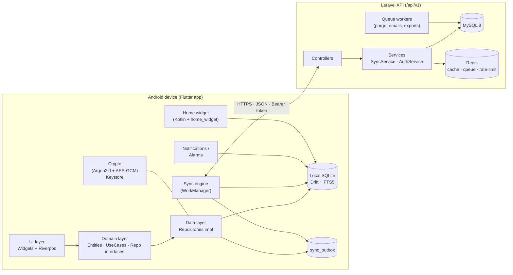
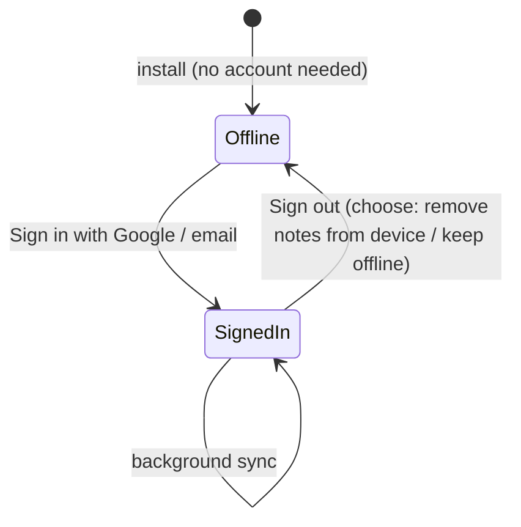
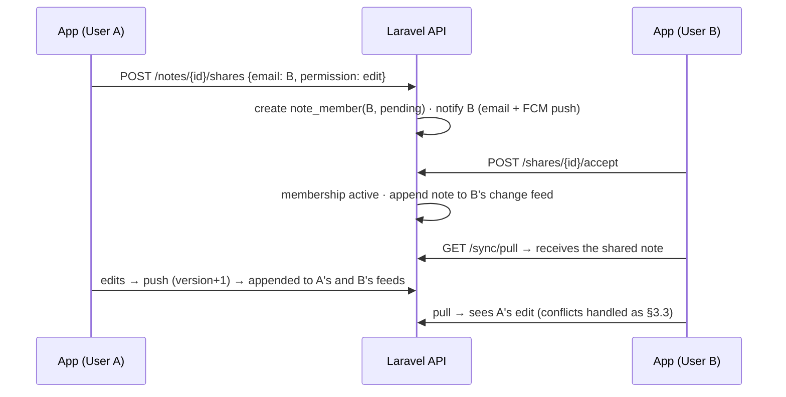
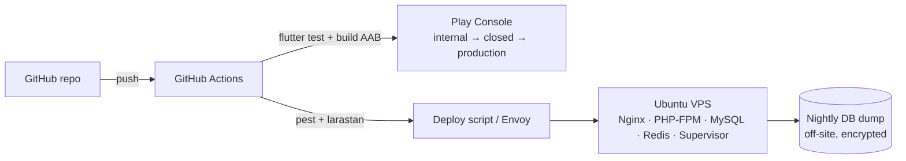

# 03 — System Architecture

## 1. High-level view



**Core principle — offline-first:** the local database is the source of truth for the UI.
The UI never waits for the network. The sync engine reconciles local ⇄ server in the background.

## 2. Mobile app (Flutter)

### 2.1 Tech choices
| Concern | Choice | Why |
|---|---|---|
| State management / DI | **Riverpod 3** (hand-written providers; family notifiers take args via constructor) | Compile-safe DI, testable, no BuildContext coupling |
| Navigation | **go_router** | Declarative, deep links (notification → note) |
| Local DB | **Drift** (SQLite) + **FTS5** | Typed queries, reactive streams, migrations, fast full-text search |
| Models | **freezed** + **json_serializable** | Immutable entities, unions for states |
| HTTP | **dio** + interceptors | Auth token, retry, logging |
| Secure storage | **flutter_secure_storage** (Android Keystore) | Tokens, wrapped encryption keys |
| Crypto | **cryptography** package (AES-256-GCM, Argon2id) | Locked notes + backups |
| Biometrics | **local_auth** | Unlock locked notes |
| Notifications | **flutter_local_notifications** + **timezone** | Reminders, status-bar pin |
| Background work | **workmanager** | Periodic sync, scheduled backup, trash purge |
| Widgets | **home_widget** + native Kotlin `AppWidgetProvider` | Sticky-note widget |
| Share | **share_plus**, **receive_sharing_intent** | Share out / in |
| i18n | **flutter_localizations** + ARB (`gen-l10n`) | |
| Lint | **very_good_analysis** (or flutter_lints strict) | |
| Tests | flutter_test, **mocktail**, integration_test | |

*Pin exact versions in `pubspec.yaml` at project start; never use `any`.*

### 2.2 Layering (Clean Architecture, feature-first)

```
Presentation  ─►  Domain  ◄─  Data
(widgets,          (entities,     (Drift DAOs, API clients,
 controllers)       use cases,     DTOs, mappers,
                    repo           repository impls)
                    interfaces)
```
- **Domain** is pure Dart: no Flutter, Drift or Dio imports.
- **Presentation** depends only on domain (via Riverpod providers).
- **Data** implements domain repository interfaces.

### 2.3 Folder structure

```
app/                                  # Flutter project root
├─ lib/
│  ├─ main.dart                       # bootstrap only
│  ├─ app/                            # MaterialApp, router, theme, l10n wiring
│  │  ├─ router.dart
│  │  └─ theme/ (colors.dart, note_palette.dart, typography.dart)
│  ├─ core/                           # cross-cutting, no feature logic
│  │  ├─ database/ (app_database.dart, tables/, migrations/)
│  │  ├─ network/ (dio_client.dart, interceptors/, api_exception.dart)
│  │  ├─ crypto/ (key_manager.dart, cipher.dart)
│  │  ├─ error/ (failure.dart, result.dart)
│  │  ├─ utils/ (clock.dart, uuid.dart, debouncer.dart)
│  │  └─ widgets/                    # shared UI components
│  ├─ features/
│  │  ├─ notes/
│  │  │  ├─ domain/ (note.dart, checklist_item.dart, note_color.dart,
│  │  │  │           notes_repository.dart, usecases/)
│  │  │  ├─ data/ (notes_dao.dart, note_mapper.dart, notes_repository_impl.dart)
│  │  │  └─ presentation/ (note_list/, note_editor/, controllers/)
│  │  ├─ search/
│  │  ├─ reminders/
│  │  ├─ lock/
│  │  ├─ backup/
│  │  ├─ sync/
│  │  ├─ auth/
│  │  ├─ calendar/                    # v1.1
│  │  ├─ widgets_home/                # v1.1
│  │  └─ settings/
│  └─ l10n/ (app_en.arb, app_hi.arb)
├─ android/app/src/main/kotlin/.../  # widget provider, boot receiver
├─ test/        (mirrors lib/)
└─ integration_test/
```

**Adding a new feature = add a folder under `features/`** with the same three sub-layers. Features talk to each other only through domain interfaces/providers, never by importing another feature's `data/` or `presentation/`.

### 2.4 Key flows

**Edit → save → sync**
```mermaid
sequenceDiagram
  participant E as Editor
  participant C as NoteEditorController
  participant R as NotesRepository
  participant D as Drift DB
  participant S as SyncEngine
  E->>C: onChanged(text)
  C->>C: debounce 500ms
  C->>R: save(note)
  R->>D: tx { upsert note (updated_at, dirty=1); insert outbox }
  D-->>E: stream emits updated note
  Note over S: WorkManager / app resume / connectivity change
  S->>D: read outbox
  S->>API: POST /sync/push
  S->>API: GET /sync/pull?cursor=
  S->>D: apply server changes, clear outbox
```

**Reminder**
- Saving a note with `reminder_at` → `ReminderScheduler.schedule(noteId)` (exact alarm via `flutter_local_notifications.zonedSchedule`).
- On boot / app update / timezone change → reschedule all active reminders from DB (native `BOOT_COMPLETED` receiver handled by plugin).
- Repeating reminder: after firing, compute next occurrence and reschedule (rules in `features/reminders/domain/recurrence.dart`).
- Android 12+: request `SCHEDULE_EXACT_ALARM` / use `USE_EXACT_ALARM` only if policy allows; fall back to inexact with user notice. Android 13+: request `POST_NOTIFICATIONS`.

## 3. Accounts & sync design

### 3.1 Account lifecycle (offline → Google account → new device)

| Situation | What happens |
|---|---|
| **First sign-in on a device that already has offline notes** | All local notes are pushed to the account (they're new to the server, `base_version = 0`), then everything from the server is pulled. Result = union of both; UUIDs mean no duplicates. |
| **Sign in on a new / reinstalled device with the same Google account** | Full pull (`cursor = 0`) downloads all notes, colour labels and settings. Locked notes arrive still encrypted — they open after the user enters the master password (§3.4). Reminders are re-scheduled locally from the synced data. |
| **Two devices on the same account** | Both push/pull continuously; edits appear on the other device on its next sync (≤ 30 min background, instant on app open). Optional v1.1: FCM "tickle" push so the other device syncs within seconds. |
| **Sign out** | Pending changes are pushed first. User chooses "Remove notes from this device" (default) or "Keep as offline notes". |
| **Delete account** | Server data deleted; local notes stay on the device as offline notes. |

Server-side backup = the synced data itself (MySQL, backed up nightly). The local encrypted backup file (FR-B1) still exists for users who never sign in.

### 3.2 Sync model (sharing-ready)
Designed now so that **note sharing (§3.5) can be added later without redesigning sync**.
- Every syncable record has a **client-generated UUID v7** `id` (sortable, offline-safe).
- Each note has a server **`version`** (int, +1 on every change) → used for conflict detection.
- Each user has a personal **change feed** (`change_log`): whenever a note changes, a row is appended to the feed of **every user who can access it** (owner now; owner + shared members later), with a per-user monotonically increasing `seq`.
- Client stores `sync_cursor` = last `seq` it has seen.
- Each local record keeps `base_version` (server version it was last synced from) and a `dirty` flag.
- Deletes are **tombstones** (`deleted_at` set) — never hard-deleted until purged on both sides.

### 3.3 Protocol
1. **Push**: `POST /api/v1/sync/push` with dirty records `{id, base_version, data}`.
   - If server `version == base_version` (and user has edit permission) → accept, `version + 1`, append to feeds of all members.
   - Else → **conflict**: server returns its copy; client keeps the server copy as the note and saves its local edits as a **new note** `"<title> (conflicted copy – <device>, <date>)"`. No silent loss.
2. **Pull**: `GET /api/v1/sync/pull?cursor=<seq>&limit=500` → feed entries with `seq > cursor` (latest state of each changed note), plus `next_cursor`, `has_more`.
3. Apply pulled changes in one transaction; skip records that are locally dirty (they'll conflict on next push).
4. Repeat until `has_more=false`. Triggers: app start, resume, after local edit (debounced 5 s), connectivity regained, every 30 min via WorkManager.

### 3.4 Master password & locked notes (works across devices)
Key hierarchy — a random key encrypts notes; the password only *wraps* that key:
```
master password ──Argon2id(salt)──► KEK (never stored)
                                     │ unwraps
recovery key (24 chars, optional) ──► KEK2
                                     ▼
                     DEK (random AES-256 key) ──AES-GCM──► locked note title + body
```
- **DEK** (data encryption key) is generated once, on device. Stored **wrapped** (encrypted by KEK) locally and — once signed in — on the server (`users.wrapped_dek`, `kdf_salt`, `kdf_params`). The server never sees the password, KEK or plain DEK.
- **New device:** after sign-in, the user taps a locked note → enters master password → app downloads salt + wrapped DEK → derives KEK → unwraps DEK → decrypts. Same password works everywhere.
- **Change master password:** only re-wraps the DEK (instant), no need to re-encrypt every note.
- **Forgot password:** unrecoverable *unless* the user saved the optional **recovery key** at setup. Shown clearly in UI.
- **Biometrics:** after one successful password entry, the DEK is stored in Android Keystore behind biometric auth for that device.
- **Offline-first edge case:** if the user set a master password offline and later signs into an account that already has a different one, the app asks for the account's master password, then re-encrypts local locked notes with the account DEK.
- Locked notes: excluded from search index, widgets show "🔒", FLAG_SECURE in editor, auto-relock after N minutes in background.
- Optional (v1.1): **app lock** (PIN/biometric to open the app at all), separate from note lock.
- Backups: whole archive encrypted with AES-GCM; key from backup password (Argon2id).

### 3.5 Note sharing between users (planned, Phase 4)
User A shares a specific note with user B (both have accounts).

- **Permissions:** `owner` (edit, share, delete for everyone), `editor` (edit), `viewer` (read-only).
- Shared notes show a "shared" badge + avatars; B can **leave** a share; A can **revoke** it (B's copy is removed via tombstone in B's feed).
- **Per-user fields stay personal:** colour, pinned, archived, reminder belong to each member (`note_members` row), so B's reminder doesn't ring on A's phone. Title/body/checklist are shared.
- **Locked notes cannot be shared** in the first version (they're encrypted with the owner's DEK). Future: per-note keys wrapped with each member's public key (X25519) for end-to-end encrypted sharing.
- Invite a user who has no account → email invite link; share activates when they sign up with that email.
- Real-time feel: FCM data message "sync now" to members' devices after each change. Live co-editing (character-level) is out of scope; conflicts produce conflicted copies.

## 4. Backend (Laravel)

### 4.1 Tech choices
| Concern | Choice |
|---|---|
| Framework | Laravel (latest stable LTS-supported), PHP 8.3+ |
| Auth | **Laravel Sanctum** personal access tokens (mobile); Google sign-in via ID-token verification (`google/apiclient` or Socialite `userFromToken`) |
| DB | MySQL 8 (InnoDB, utf8mb4) |
| Cache / queue / rate-limit | Redis |
| Queue runner | Horizon (or `queue:work` under Supervisor) |
| Validation | FormRequest classes |
| Responses | API Resources |
| Tests | Pest (Feature + Unit), SQLite or MySQL test DB |
| Static analysis | Larastan (level ≥ 6), Laravel Pint |
| Docs | OpenAPI via Scribe (generated from code) |

### 4.2 Folder structure
```
api/                                   # Laravel project root
├─ app/
│  ├─ Http/
│  │  ├─ Controllers/Api/V1/ (AuthController, SyncController, AccountController, ...)
│  │  ├─ Requests/V1/
│  │  ├─ Resources/V1/
│  │  └─ Middleware/
│  ├─ Models/ (User, Note, ColorLabel, Device, ChangeLog)
│  ├─ Services/ (SyncService, AuthService, AccountDeletionService)
│  ├─ Actions/                        # single-purpose operations
│  ├─ Jobs/ (PurgeTrashJob, DeleteAccountJob, ExportUserDataJob)
│  └─ Policies/
├─ database/migrations/
├─ routes/api.php                      # all routes under /api/v1
└─ tests/ (Feature/, Unit/)
```

### 4.3 Request lifecycle
`Nginx → PHP-FPM → Laravel → middleware (auth:sanctum, throttle, force-json) → FormRequest → Controller (thin) → Service → Eloquent/DB transaction → Resource → JSON`

## 5. Deployment


- Environments: `local`, `staging` (api-staging.<domain>), `production` (api.<domain>).
- App flavours: `dev` (points to local/staging), `prod`.
- HTTPS only (Let's Encrypt), HSTS.

## 6. Extensibility rules (how new features plug in)
1. New feature → new `features/<name>/` module in Flutter + new controller/service in Laravel.
2. Schema change → new Drift schema version + migration test; new Laravel migration (never edit old ones).
3. API change → additive only within `/v1`; breaking change → `/v2` while keeping `/v1` alive ≥ 6 months.
4. New syncable entity → add to the generic `sync` payload (`entity_type`) instead of new sync endpoints.
5. Feature flags: `RemoteConfig` endpoint `GET /api/v1/config` + local defaults, for staged rollouts.

## 7. Architecture Decision Records
Record significant decisions in `docs/adr/NNNN-title.md` (context → decision → consequences).
Initial ADRs:
- 0001 Flutter for client (Android first)
- 0002 Offline-first with local SQLite as source of truth
- 0003 Laravel + MySQL backend with Sanctum
- 0004 Revision-based sync with conflict copies
- 0005 Client-side encryption for locked notes (DEK wrapped by master password)
- 0006 Sharing-ready data model (`note_members` + per-user change feed) from v1.0
